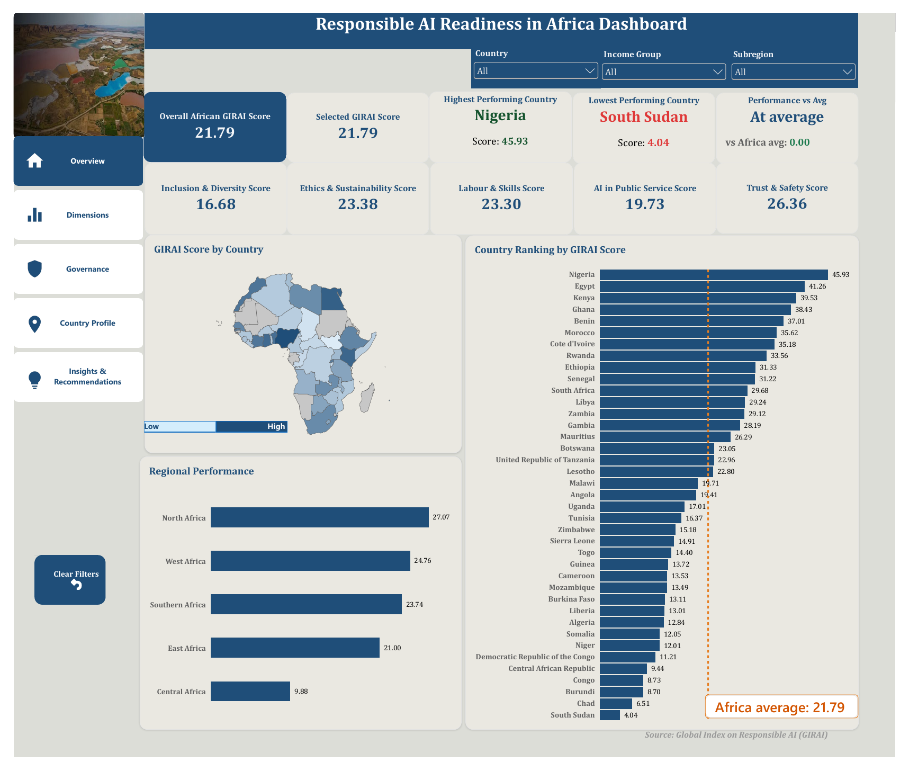
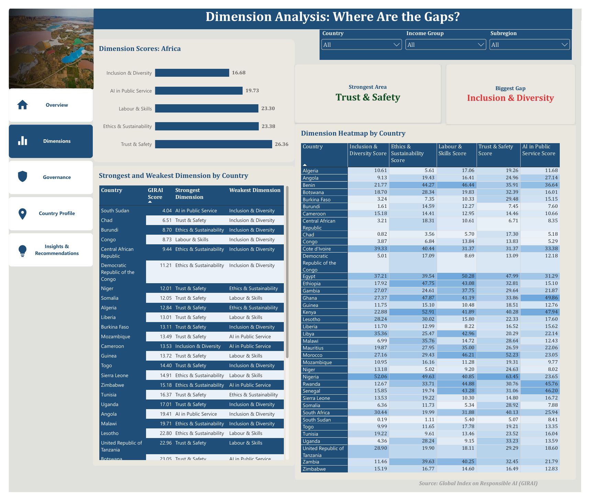
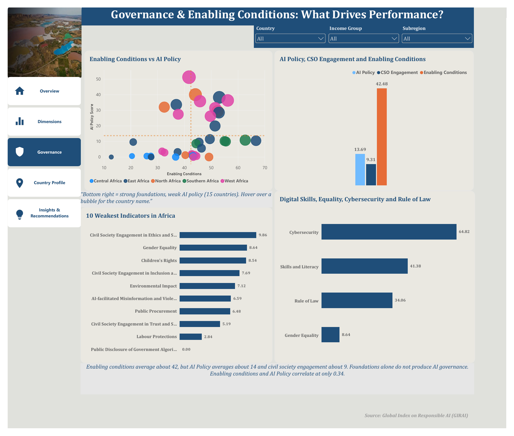
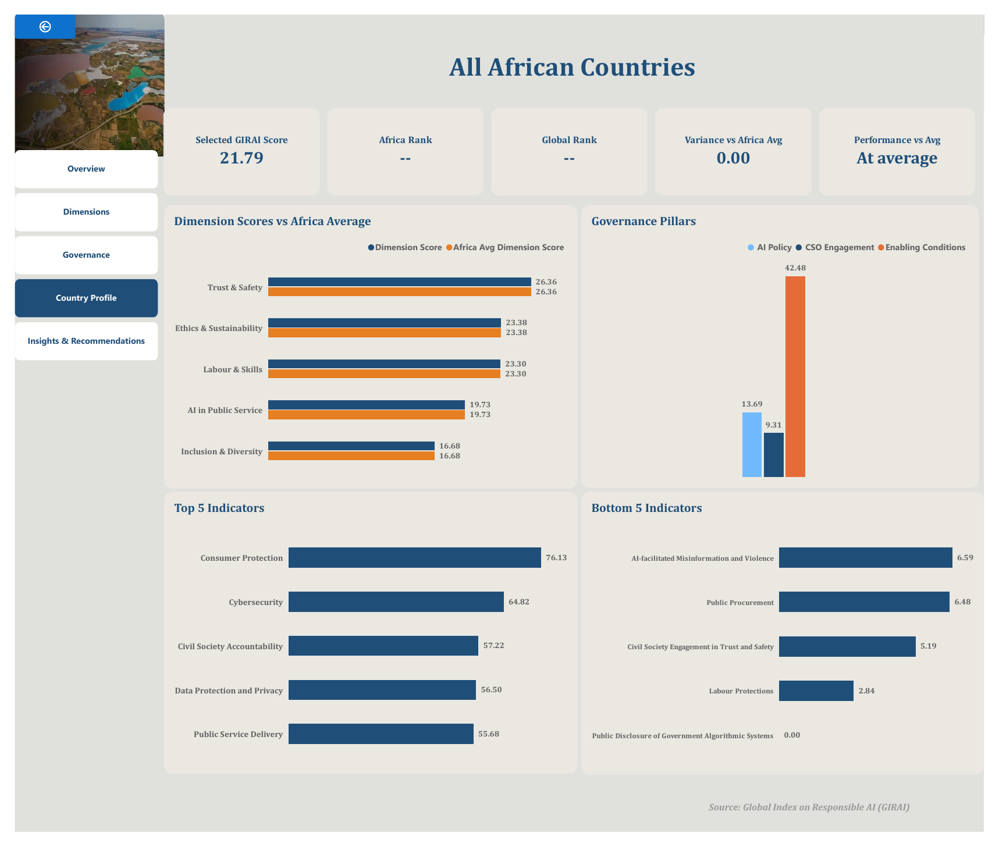
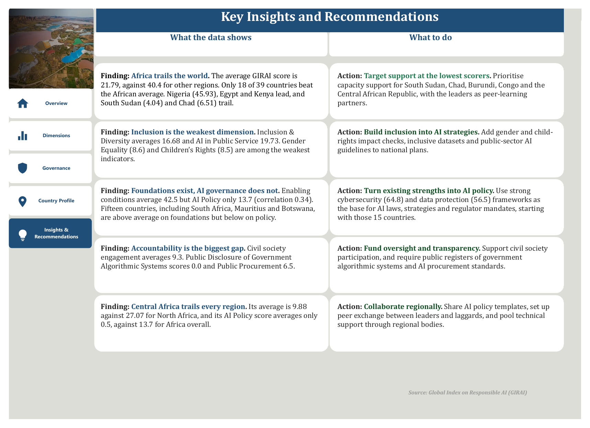

# Responsible AI Readiness in Africa Dashboard

An interactive **Power BI** dashboard that measures how ready 39 African countries are to govern AI responsibly, using data from the **Global Index on Responsible AI (GIRAI)**.

🏆 **One of the winning teams, Data Analytics Track, DSN AI Bootcamp 2026 Hackathon** (African Responsible AI Challenge), built by **Team Debuggers**.

---

## 📌 Project Overview

AI is spreading quickly across Africa, but are countries putting the right safeguards in place? The dashboard answers four questions:

1. **How does Africa score** on responsible AI, and which countries lead or trail?
2. **Which dimensions** (inclusion, ethics, skills, public service, trust and safety) show the biggest gaps?
3. **What drives performance:** do strong foundations such as cybersecurity and rule of law lead to real AI policy?
4. **What should governments, civil society and regional bodies do next?**

## 🛠️ Tools & Skills

| Tool | Used for |
|---|---|
| **Power BI Desktop** | Data modelling, interactive visuals and page navigation |
| **Power Query** | Cleaning and shaping the GIRAI dataset |
| **DAX** | Measures for averages, rankings, variance vs Africa average, strongest/weakest dimension per country |
| **Design** | Country, Income Group and Subregion slicers, a drill-through country profile, a "Clear Filters" button and a consistent colour theme |

## 📊 Dashboard Pages

### 1. Overview
The Africa average GIRAI score, the highest and lowest performing countries, the five dimension scores, a choropleth map, a country ranking against the Africa average, and regional performance.

### 2. Dimensions: Where Are the Gaps?

Dimension scores for Africa, each country's strongest and weakest dimension, and a country-by-dimension heatmap.

### 3. Governance & Enabling Conditions: What Drives Performance?

A bubble chart of enabling conditions vs AI policy by region, the three governance pillars, the 10 weakest indicators, and digital skills, equality, cybersecurity and rule of law.

### 4. Country Profile

A drill-through page showing any country's score, Africa and global rank, variance from the Africa average, dimension scores vs the average, governance pillars, and top and bottom 5 indicators.

### 5. Key Insights & Recommendations

---

## 🔢 Key Metrics

| Metric | Value |
|---|---|
| Countries analysed | **39** |
| Africa average GIRAI score | **21.79** (vs 40.4 for other regions) |
| Highest performer | **Nigeria (45.93)** |
| Lowest performer | **South Sudan (4.04)** |
| Countries above the Africa average | **18 of 39** |
| Strongest dimension | **Trust & Safety (26.36)** |
| Weakest dimension | **Inclusion & Diversity (16.68)** |
| Enabling Conditions / AI Policy / CSO Engagement | **42.48 / 13.69 / 9.31** |

## 💡 Key Insights

- **Africa trails the world.** The average GIRAI score is 21.79, about half the 40.4 average for other regions. Nigeria (45.93), Egypt (41.26) and Kenya (39.53) lead, while South Sudan (4.04) and Chad (6.51) trail.
- **Inclusion is the weakest dimension** at 16.68, followed by AI in Public Service (19.73). Gender Equality (8.64) and Children's Rights (8.54) are among the weakest indicators.
- **Foundations exist, but AI governance does not.** Enabling conditions average 42.5, but AI Policy averages only 13.7, and the two correlate at just 0.34. Fifteen countries, including South Africa, Mauritius and Botswana, have above-average foundations but below-average AI policy.
- **Accountability is the biggest gap.** Civil society engagement averages 9.3, Public Disclosure of Government Algorithmic Systems scores 0.00, and Public Procurement 6.48.
- **Central Africa trails every region** at 9.88, against 27.07 for North Africa, and its AI Policy is close to zero.
- **There are existing strengths to build on:** Consumer Protection (76.13), Cybersecurity (64.82) and Data Protection & Privacy (56.50) are Africa's top indicators.

## ✅ Recommendations

1. **Target support at the lowest scorers.** Prioritise capacity support for South Sudan, Chad, Burundi, Congo and the Central African Republic, with the leaders as peer-learning partners.
2. **Build inclusion into AI strategies.** Add gender and child-rights impact checks, inclusive datasets and public-sector AI guidelines to national plans.
3. **Turn existing strengths into AI policy.** Use cybersecurity and data protection frameworks as the base for AI laws, strategies and regulator mandates, starting with the 15 "strong foundations, weak policy" countries.
4. **Fund oversight and transparency.** Support civil society participation, and require public registers of government algorithmic systems and AI procurement standards.
5. **Collaborate regionally.** Share AI policy templates, set up peer exchange between leaders and laggards, and pool technical support through regional bodies.

## 📚 Data Source

[Global Index on Responsible AI (GIRAI)](https://www.global-index.ai/), country-level scores for 39 African countries across five dimensions, three governance pillars and individual indicators.

## 📁 Repository Contents

| File | Description |
|---|---|
| `1-overview.png` | Overview page |
| `2-dimensions.png` | Dimension analysis page |
| `3-governance.png` | Governance & enabling conditions page |
| `4-country-profile.png` | Country profile page |
| `5-insights-recommendations.png` | Key insights & recommendations |
| `Responsible-AI-Readiness-Africa-Dashboard.pdf` | Full dashboard exported as PDF |

---

## 👥 Team

Built by **Team Debuggers** for the DSN 2026 AI Bootcamp Hackathon:

- **Aghogho Awaritoma**
- **Joy Jacob**
- **Raji Aisha**
- **Ufuoma Avworu**

**Repository maintained by Aghogho (Faith) Awaritoma**, Data Analyst · Power BI · Tableau · Excel · SQL
🔗 [LinkedIn](https://www.linkedin.com/in/awaritomafaith) · [GitHub](https://github.com/Aghogho-data)
